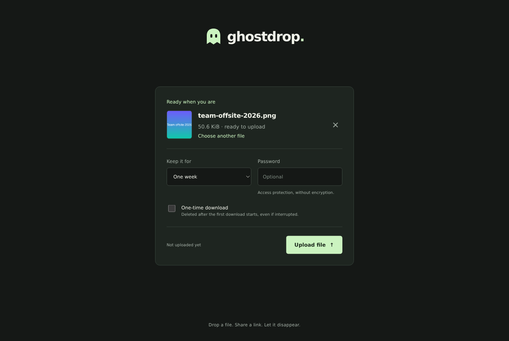
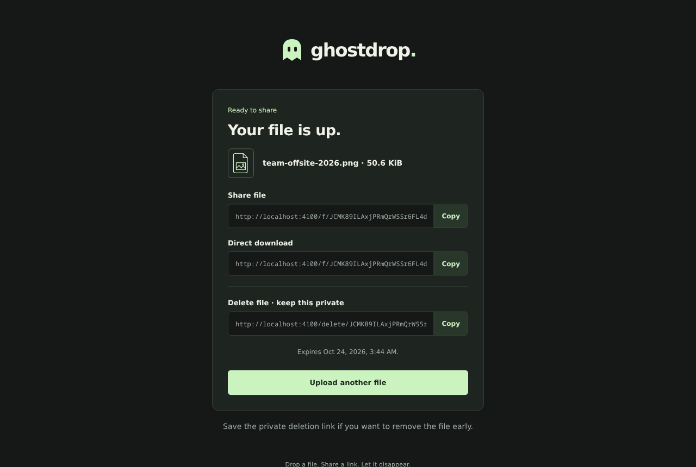
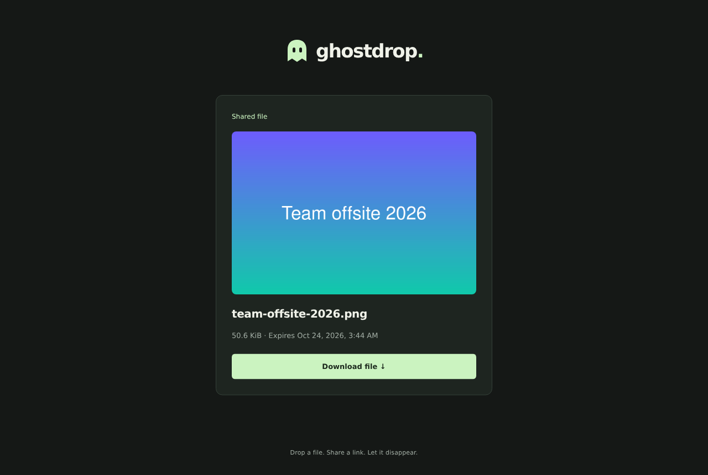
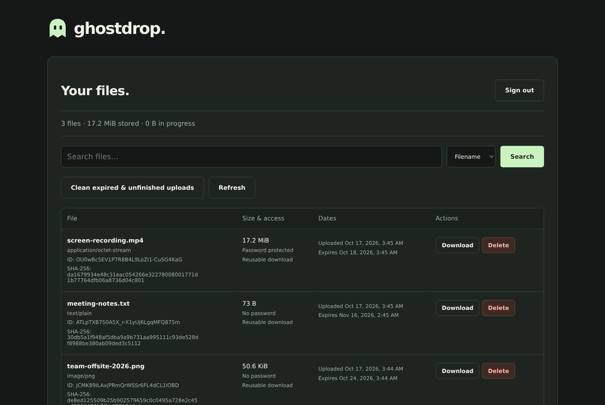

# Ghostdrop

Simple, temporary, self-hosted file sharing. Drop a file, share a link, and it disappears after the time you choose or after its first download. A spiritual successor to [Jirafeau](https://gitlab.com/jirafeau/Jirafeau), written from scratch.

<p align="center">
  
  
  
  
</p>

## Features

- **Expiring links**: one hour, one day, one week or 30 days.
- **One-time downloads**, claimed atomically so two simultaneous requests can never both get the file.
- **Password-protected files**, plus a private deletion link for every upload.
- **Resumable uploads** in 512 KiB chunks that survive flaky connections and backend restarts, and pass through proxies with small body limits.
- **Safe previews** for images and plain text; everything else, including HTML and SVG, is only ever downloaded.
- **Optional upload restrictions**: an upload password, an IP allowlist, or both. Downloads stay public.
- **Admin panel** with search by name, hash or link, storage totals, deletion and cleanup.
- **English and Castilian Spanish**: the UI follows the browser language, with a discreet footer selector and a `?lang=` override. API errors carry stable codes, so they are localized too.
- **Local disk or S3-compatible storage** (AWS, MinIO), a global storage cap, and no database server: metadata lives in SQLite.

## Quick start

With Docker:

```sh
git clone https://github.com/GodGMN/ghostdrop.git
cd ghostdrop/deploy
cp .env.example .env
docker compose up -d --build
```

Open http://localhost:8080. To serve it on your own domain with automatic HTTPS, see [Docker Compose](#docker-compose). For development without Docker, see [Development](#development).

## Security model

What Ghostdrop protects:

- **Served files can't attack the site.** Downloads are sent as `attachment` with `application/octet-stream`, `nosniff` and a sandboxing Content Security Policy. Inline previews are limited to PNG, JPEG, GIF and WebP identified by their bytes, and plain text.
- **One-time files are downloaded once.** The claim is a single atomic database update, and the stored bytes are removed before streaming begins.
- **Passwords and tokens are never stored in plaintext.** File, admin and upload passwords are salted scrypt hashes; deletion and upload tokens are stored as SHA-256 hashes. Deletion tokens live in the URL fragment, so they never reach server logs.
- **Cross-site requests are rejected.** Mutating requests must come from `PUBLIC_ORIGIN`; cookies are `HttpOnly` and `SameSite=Strict`; admin actions also need a CSRF token. Password attempts and upload starts are rate limited per client IP.
- **Uploader IP addresses are not stored.**

What it does not do:

- **No encryption.** File passwords control access; they do not encrypt anything. Whoever runs the server can read every file.
- **Uploads are open by default.** Configure an [upload password or IP allowlist](#restricting-uploads) and `MAX_TOTAL_BYTES` for a public instance. Files are not scanned for malware.
- **Behind a reverse proxy, rate limits need `TRUST_PROXY`**, otherwise every visitor shares the proxy's address.
- **Deletion is not secure erasure**, and does not reach copies in your backups.

To report a vulnerability, see [SECURITY.md](SECURITY.md).

## Sharing files

Select or drop one file. Selection and settings stay in the browser until you click **Upload file**. Set an optional access password, a one-time download rule, and an expiration of one hour, one day, one week, or 30 days. The default is 30 days.

Images show a local thumbnail on selection. Other files show an icon for their type; unknown types show a page with a short extension label.

After upload, copy the sharing page or direct download link. The sharing page automatically previews PNG, JPEG, GIF, WebP, and text files up to 1 MiB. Password-protected and one-time files have no preview. Uploaded HTML and SVG are downloadable attachments, never application pages. Text previews show literal text. Old preview-page URLs redirect to the sharing page.

Keep the separate deletion link private. Opening it shows a confirmation; clicking **Delete this file** removes the file and its sharing links. The deletion token is in the URL fragment and is not sent with the page request.

Passwords control access to the bytes, without encrypting them. They are stored as salted scrypt hashes. Successful verification grants the current browser 30 minutes of access to that file; direct links still require verification in another browser. File contents remain accessible to the server administrator.

One-time files are claimed atomically when a download is accepted. The stored file is unlinked before streaming from the open descriptor. Only the first concurrent request succeeds, and an interrupted accepted transfer still consumes the file. Metadata requests do not consume it; previews, HEAD downloads, and ranges are disabled. Range/resume downloads are currently unsupported for all files.

## Restricting uploads

Uploads are open to anyone by default. Two optional restrictions limit who can upload; downloads, sharing pages and deletion links stay public either way.

- **Upload password.** Generate a hash with `npm run hash-password` and set it as `UPLOAD_PASSWORD_HASH`. The landing page then asks for the password before showing the drop zone. A correct password unlocks uploads in that browser for 12 hours. Attempts are rate limited like admin logins.
- **IP allowlist.** Set `UPLOAD_ALLOWED_IPS` to a comma-separated list of addresses or CIDR ranges, for example `192.168.1.0/24,2001:db8::/32`. Other clients see an "uploads are restricted" page and every upload request returns 403.

When both are set, both apply. Upload sessions live in memory, so a restart asks for the password again.

Behind a reverse proxy, set `TRUST_PROXY` so Ghostdrop sees the visitor's address instead of the proxy's. The allowlist and every rate limit depend on it. Use the number of proxies in front of the backend (`1` for Coolify, Traefik or the bundled Docker Compose setup), or their addresses (`loopback`, `uniquelocal` or CIDRs). Leave it unset when Node faces the internet directly: a trusted `X-Forwarded-For` header can be forged by anyone who reaches the backend without passing through the proxy. `TRUST_PROXY=true` is rejected for that reason.

## Admin

Admin is disabled until a password hash is configured. Generate a hash with a hidden prompt:

```sh
npm run hash-password
```

Set the result as `ADMIN_PASSWORD_HASH` in `.env`, then restart and open `/admin`. Do not put the plaintext password in the configuration.

The panel lists files with size, content type, hash, creation and expiration dates, and access restrictions. Search by filename, full SHA-256, or share ID/link. It also shows disk usage, supports downloads and confirmed deletion, and runs cleanup for expired files and inactive partial uploads. Admin downloads bypass the file password but still consume one-time files. Uploader IP addresses are not stored.

## Storage

SQLite metadata and uploaded files live in `DATA_DIR` (default `./data`), outside the public directory. Preserve this directory across restarts. The default upload limit is 100 MiB per file. Configure `MAX_FILE_BYTES` to change it. Set `MAX_TOTAL_BYTES` to cap total storage: it counts stored files plus the declared size of unfinished uploads, and new uploads that would exceed it are refused with HTTP 507 until expired files are cleaned up.

With `STORAGE_BACKEND=s3`, finalized file bytes go to S3-compatible storage instead. SQLite and resumable upload staging still live in `DATA_DIR`, which must remain persistent.

Expiry blocks new access immediately. A cleanup loop physically removes expired files at startup and every minute, retries pending deletions, removes orphaned completed uploads, and expires upload sessions after one hour without an acknowledged chunk. Expiring a completed session only removes its cached receipt; the shared file keeps its own expiration. An already-open download can finish after expiry. The process must be running for background cleanup to run.

Run a single application process against each data directory. In-memory upload tracking and sessions are intentionally scoped to that process. Admin and file-access sessions are invalidated on restart; uploaded files and password hashes persist. Back up metadata and file bytes together while the application is stopped. File deletion also removes the SQLite record, but does not erase copies in external backups or guarantee secure erasure on the underlying disk.

## Configuration

| Variable               | Default                 | Purpose                                                |
| ---------------------- | ----------------------- | ------------------------------------------------------ |
| `PORT`                 | `3000`                  | HTTP port                                              |
| `HOST`                 | `127.0.0.1`             | Listen address; use `0.0.0.0` for LAN/container access |
| `PUBLIC_ORIGIN`        | `http://localhost:3000` | Exact browser origin allowed for mutating requests     |
| `DATA_DIR`             | `./data`                | Private database and upload storage                    |
| `MAX_FILE_BYTES`       | `104857600`             | Maximum size of a single file, in bytes                |
| `MAX_TOTAL_BYTES`      | Unlimited               | Cap on stored plus in-progress upload bytes            |
| `ADMIN_PASSWORD_HASH`  | Empty                   | Generated scrypt hash; empty disables admin            |
| `COOKIE_SECURE`        | `false`                 | Set `true` when serving through HTTPS                  |
| `UPLOAD_PASSWORD_HASH` | Empty                   | Generated scrypt hash; empty leaves uploads open       |
| `UPLOAD_ALLOWED_IPS`   | Empty                   | Comma-separated IPs/CIDRs allowed to upload            |
| `TRUST_PROXY`          | Unset                   | Proxy hop count or addresses; see Restricting uploads  |
| `CLEANUP_INTERVAL_MS`  | `60000`                 | Background cleanup interval                            |
| `STORAGE_BACKEND`      | `local`                 | Finalized file storage: `local` or `s3`                |
| `S3_ENDPOINT`          | AWS default             | S3 API origin, e.g. the MinIO endpoint                 |
| `S3_BUCKET`            | Required for S3         | Existing private bucket                                |
| `S3_REGION`            | `us-east-1`             | Bucket signing region                                  |
| `S3_PREFIX`            | `ghostdrop/`            | Reserved key prefix; must end with `/`                 |
| `S3_FORCE_PATH_STYLE`  | `true`                  | Path-style addressing for MinIO                        |
| `S3_ACCESS_KEY_ID`     | SDK credential chain    | Server-side access key ID                              |
| `S3_SECRET_ACCESS_KEY` | SDK credential chain    | Server-side secret access key                          |
| `S3_SESSION_TOKEN`     | Empty                   | Optional temporary AWS credential token                |

For production, build the two Docker images below, mount persistent private storage on the backend, and put the frontend behind an HTTPS reverse proxy. Set `PUBLIC_ORIGIN` to the external HTTPS origin and `COOKIE_SECURE=true`. Browser file requests are at most 512 KiB, so nginx's default 1 MiB request-body limit can stay unchanged even when `MAX_FILE_BYTES` is much larger. No nginx configuration is required when serving Node directly. A mismatched origin is rejected. Do not serve `DATA_DIR` as static content.

### Docker Compose

The quickest way to run Ghostdrop anywhere Docker runs. `deploy/docker-compose.yml` builds both apps from this checkout and puts [Caddy](https://caddyserver.com) in front of them, so `/api/*` reaches the backend and everything else the frontend on a single origin. Files and the database live in the `ghostdrop-data` volume.

```sh
cd deploy
cp .env.example .env
docker compose up -d --build
```

Open http://localhost:8080. For a public server, point DNS at the machine and set these in `deploy/.env`; Caddy then obtains and renews a TLS certificate automatically:

```dotenv
GHOSTDROP_SITE=drop.example.com
HTTP_PORT=80
HTTPS_PORT=443
PUBLIC_ORIGIN=https://drop.example.com
COOKIE_SECURE=true
```

Generate admin or upload password hashes with `docker compose run --rm -it backend node apps/backend/scripts/hash-password.js`. `TRUST_PROXY=1` is preset because Caddy is one proxy hop. If another proxy sits in front of Caddy, increase it and add that proxy to Caddy's [`trusted_proxies`](https://caddyserver.com/docs/caddyfile/options#trusted-proxies); Caddy otherwise replaces any incoming `X-Forwarded-For`, so clients cannot spoof their address. Back up the `ghostdrop-data` volume while the stack is stopped.

### Docker

Both Dockerfiles use the repository root as their build context:

```sh
docker build -f apps/backend/Dockerfile -t ghostdrop-backend .
docker build -f apps/frontend/Dockerfile -t ghostdrop-frontend .
```

The frontend listens on container port 80 and the backend on port 3000. Deploy behind a path-aware reverse proxy: route `/api/*` to the backend and all other paths to the frontend. The API accepts both bare paths and paths prefixed with `/api`, so prefix stripping is supported. The Coolify settings below configure those routes. A raw frontend container serves only static files and returns 404 for API paths; it has no internal backend proxy or production environment variables.

The backend runs Node 24 as the unprivileged `node` user and installs only its production workspace dependencies. Its health check probes `/api/config`. The frontend uses the official nginx Alpine image with a static configuration and checks `/healthz`. The build context excludes personal MCP configurations, `.env`, Git history, local storage, tests and design mockups.

Keep the `ghostdrop-data` volume when replacing the backend. It contains SQLite metadata and local uploads/staging. A bind mount needs write permission for UID/GID 1000; a new named volume inherits the image directory's ownership. Back up metadata and file bytes consistently. Run one backend per data directory and S3 prefix.

To generate an admin password hash with the backend image:

```sh
docker run --rm -it --entrypoint node ghostdrop-backend apps/backend/scripts/hash-password.js
```

Set the resulting hash as `ADMIN_PASSWORD_HASH` on the backend. Admin access remains disabled without it.

### Coolify: two applications

Create two Dockerfile applications from the same private repository and branch `main`. Use these settings:

| Setting             | Frontend                    | Backend                                 |
| ------------------- | --------------------------- | --------------------------------------- |
| Base directory      | `/`                         | `/`                                     |
| Dockerfile location | `/apps/frontend/Dockerfile` | `/apps/backend/Dockerfile`              |
| Ports Exposes       | `80`                        | `3000`                                  |
| Port Mappings       | Empty                       | Empty                                   |
| Public domain       | `https://drop.example.com`  | `https://drop.example.com:3000/api`     |
| Persistent volume   | None                        | `ghostdrop-data` mounted at `/app/data` |
| Health check        | `/healthz`, port 80         | `/api/config`, port 3000                |

Leave build/start commands empty. In Coolify's domain dialog, use host `drop.example.com`, frontend port `80` with no path, and backend port `3000` with path `/api/`. These ports are internal; visitors use normal HTTPS port 443. Leave the default path-prefix handling unchanged. The backend accepts both `/config` and `/api/config`. Every path goes through the same origin, authentication and CSRF checks. No custom labels are needed. See [Coolify path routing](https://coolify.io/docs/core/networking/domains).

Enable **Consistent Container Names** on the backend to stop the old instance before starting its replacement. Do not enable overlapping backend instances or share its data/S3 namespace with preview deployments. No specific backend hostname or frontend-to-backend network connection is required. Coolify's proxy must be able to reach both apps. Its [deployment settings](https://coolify.io/docs/applications/deployments/rolling-updates) describe stop-first behavior.

The frontend needs **no environment variables**. Remove `BACKEND_URL` from its Coolify configuration. That variable is only used by the local Node development frontend when running it separately.

The backend runtime variables for an S3 deployment are:

```dotenv
NODE_ENV=production
HOST=0.0.0.0
PORT=3000
PUBLIC_ORIGIN=https://your-ghostdrop.example.com
COOKIE_SECURE=true
DATA_DIR=/app/data
MAX_FILE_BYTES=104857600
CLEANUP_INTERVAL_MS=60000
STORAGE_BACKEND=s3
S3_ENDPOINT=https://your-minio-api.example.com
S3_BUCKET=ghostdrop-prod
S3_REGION=us-east-1
S3_PREFIX=ghostdrop/
S3_FORCE_PATH_STYLE=true
S3_ACCESS_KEY_ID=your-access-key
S3_SECRET_ACCESS_KEY=your-secret-key
ADMIN_PASSWORD_HASH=
TRUST_PROXY=1
```

`PUBLIC_ORIGIN` is the frontend's exact public HTTPS origin, with no internal port. Create the private production bucket before deployment, with versioning never enabled. Keep production storage separate from development. S3 credentials and the admin hash belong only on the backend. All application variables are runtime-only; disable Build Variable in Coolify. The production frontend has no environment variables or browser API URL. For storage configuration, see [Coolify persistent storage](https://coolify.io/docs/applications/configuration/persistent-storage).

Deploy the backend first, then the frontend. DNS for the public domain points to the Coolify server. Check `/api/config` through the frontend domain, upload a file and open its sharing/download links. Back up `/app/data` together with the bucket, and allow enough disk space for full-size upload staging and one-time downloads.

### S3 and MinIO

Create a private bucket dedicated to Ghostdrop, with versioning **never enabled** and no object retention. Ghostdrop checks the bucket at startup and rejects enabled or suspended versioning. Ordinary deletes in versioned buckets can retain object bytes as older versions, which conflicts with one-time and expiration deletion. See the [S3 DeleteObject documentation](https://docs.aws.amazon.com/AmazonS3/latest/API/API_DeleteObject.html).

Copy `.env.example` to a private environment file and set:

```dotenv
STORAGE_BACKEND=s3
S3_ENDPOINT=https://your-minio-api.example.com
S3_BUCKET=ghostdrop
S3_REGION=us-east-1
S3_PREFIX=ghostdrop/
S3_FORCE_PATH_STYLE=true
S3_ACCESS_KEY_ID=your-access-key
S3_SECRET_ACCESS_KEY=your-secret-key
PUBLIC_ORIGIN=https://your-ghostdrop.example.com
COOKIE_SECURE=true
```

Use the MinIO **S3 API** endpoint, usually port 9000, rather than the console on port 9001. Keep keys server-side; the public configuration endpoint and receipts never expose them. The app also accepts the SDK's default credential chain when the explicit S3 key pair is omitted, for example an AWS workload role.

For the backend Docker container, pass the private file with `--env-file /path/to/ghostdrop.env` and retain `-v ghostdrop-data:/app/data`. Omit `DATA_DIR` from that environment file or set it to `/app/data`. Credentials should permit these operations on the bucket and the reserved `ghostdrop/` object prefix, including its ownership marker:

- Bucket: `s3:ListBucket`, `s3:GetBucketVersioning`, `s3:ListBucketMultipartUploads`.
- Objects: `s3:PutObject`, `s3:GetObject`, `s3:DeleteObject`, `s3:AbortMultipartUpload`, `s3:ListMultipartUploadParts`.

Browsers continue sending 512 KiB chunks to Ghostdrop. Chunks are acknowledged only after durable local staging. Finalization streams the assembled file into S3 using multipart uploads with one part in flight, then commits its metadata and removes the local staging copy. Ordinary downloads and previews stream through Ghostdrop, preserving the same-origin routes and access controls. No public bucket, browser S3 credentials, presigned URLs or S3 CORS configuration are needed.

For one-time files, Ghostdrop streams the object to a temporary private local file, opens and unlinks that file, atomically claims the record, deletes the S3 object, then serves the open descriptor. The download begins only after remote deletion succeeds. This adds a full-file read and local staging delay to one-time downloads. Failed deletion leaves an inaccessible record that cleanup retries. Password-protected and one-time objects never receive previews.

Startup recovers interrupted finalization and temporary downloads. Cleanup removes expired/deleting objects, unreferenced object keys in the reserved prefix and abandoned multipart uploads older than one hour. Failed uploads automatically abort multipart transfers where possible. Reserve the prefix for **one Ghostdrop deployment**, preserve its SQLite metadata, and keep the endpoint, bucket and prefix stable. An ownership marker ties the prefix to its SQLite data volume. Startup refuses a different or empty database against an owned prefix, so it cannot clean another instance's files as orphans. Do not delete or overwrite this marker. Back up the database and object storage consistently.

Enabling S3 changes where **new** files are stored. Existing local files keep their backend metadata and remain readable; no automatic migration or deletion takes place. Disabling S3 or changing the bucket while remote records exist causes startup to fail. `DATA_DIR` still needs enough space for concurrent full-size uploads and temporary one-time downloads. Admin storage totals include local and remote finalized files.

To run the optional integration suite against a disposable MinIO/S3 endpoint:

```sh
TEST_S3_ENDPOINT=http://127.0.0.1:9000 \
TEST_S3_ACCESS_KEY_ID=test-access-key \
TEST_S3_SECRET_ACCESS_KEY=test-secret-key \
node --test test/s3.integration.test.js
```

These tests create and delete temporary buckets and require bucket creation/deletion and versioning-management permissions. Use an isolated test instance. The normal suite skips these integration tests unless `TEST_S3_ENDPOINT` is set.

Rate limits use the client IP. Behind a reverse proxy, set `TRUST_PROXY`; otherwise every visitor shares the proxy's rate-limit bucket. Set `MAX_TOTAL_BYTES` so public uploads cannot fill the disk. Unless an upload password or IP allowlist is configured, uploads are public. Uploads are not scanned for malware.

## Chunked uploads

The browser uses sequential 512 KiB raw-byte requests, with a shorter final chunk. Selecting a file still performs no upload or session initialization. Only clicking **Upload file** starts a session.

Each accepted chunk is written to the private partial file and synced before SQLite records its acknowledged offset. Repeating an already-acknowledged chunk verifies its bytes and returns the current offset without appending again. A conflicting or future offset is rejected. Incomplete requests do not advance the offset.

On a transient failure, the browser checks the server's offset and retries. After automatic retries are exhausted, clicking **Upload file** resumes the same file and settings from the acknowledged offset. The selected file and session credentials stay in the current page's memory. Resume survives a backend restart, but not a page reload or closing the tab. Changing the file or settings starts a new session and discards the previous attempt. Cancellation deletes the session and its bytes, including a completed file whose receipt has not reached the browser.

Finalization runs in the background and the browser polls its status with small requests. It reads the partial file through a bounded stream to calculate SHA-256, saves it to the configured backend, then commits its metadata and receipt together. Local storage uses a rename; S3 uses a streamed multipart upload. A lost finalization response is safe to retry. Startup recovery truncates bytes beyond the recorded offset and restores interrupted finalization to a resumable partial file.

| Request                                   | Purpose                                                                                                                                                           |
| ----------------------------------------- | ----------------------------------------------------------------------------------------------------------------------------------------------------------------- |
| `POST /api/uploads/sessions`              | JSON `{name,size,password?,expiration?,oneTime?,id?,token?}`; returns credentials and offset. Supplying the same random ID/token makes initialization idempotent. |
| `GET /api/uploads/sessions/:id`           | Read offset/state; a completed response includes the receipt.                                                                                                     |
| `PUT /api/uploads/sessions/:id/chunks`    | Send at most 524288 bytes with `Content-Type: application/octet-stream` and `X-Upload-Offset`.                                                                    |
| `POST /api/uploads/sessions/:id/complete` | Start finalization; returns `202` while saving, or the completed receipt.                                                                                         |
| `DELETE /api/uploads/sessions/:id`        | Cancel and delete the upload.                                                                                                                                     |

All session requests after initialization require `X-Upload-Token`. IDs/tokens are independent random 192-bit values; only a hash of the token is stored. Passwords are hashed during initialization. The private deletion token is derived from the upload secret; cached receipts do not store that token in plaintext. Sessions are capped at 1000, and initialization attempts are rate-limited.

Chunking avoids increasing nginx's request-body limit; it cannot bypass a proxy that rejects PUT requests, has a limit below 512 KiB, or cuts off a stalled individual request. Default proxy buffering only buffers a small chunk. The browser has a two-minute timeout per chunk. Uploads use one chunk request at a time, so high network latency reduces throughput. Final hashing adds one disk read of the completed file. This is a single-process implementation; file bytes use bounded buffers rather than growing server memory with the full file size.

## Development

Requires Node.js 24 or newer.

```sh
npm install
cp .env.example .env
npm run dev
```

Open http://localhost:3000. `npm run dev` starts both apps and restarts each after its code changes. The frontend listens on `FRONTEND_PORT`, falling back to `PORT` or 3000; the API listens on `BACKEND_PORT`, defaulting to the next port. Use `npm start` without watchers. For LAN access, set `HOST=0.0.0.0` and `PUBLIC_ORIGIN` to the exact frontend URL you open in the browser.

This is an npm workspace monorepo. `apps/frontend/public` contains the browser UI; `apps/frontend/server.js` is its development server. `apps/backend/src` contains the Node/Express API and storage logic. Production deploys each app independently with its own Dockerfile. The production frontend serves static assets; Coolify routes `/api/*` directly to the backend. Both apps share one browser origin. The local development frontend proxies API requests so `npm run dev` also uses one origin.

To run only one app from the repository root, use `npm run start:backend` or `npm run start:frontend`. Set `PORT` for the API and `FRONTEND_PORT` plus `BACKEND_URL` for the development frontend.

```sh
npm test
npm run check
```

`npm run format` formats the source. Node 24 currently prints an experimental warning for its built-in SQLite module.

UI copy lives in `apps/frontend/public/i18n.js`. Add a key to every catalog there; `npm test` fails if a catalog is missing a key, if placeholders differ, or if a backend error code has no message.

## Manual verification

1. Select or drop a file and change settings. Confirm the browser Network panel has no upload request until **Upload file** is clicked.
2. Upload a text file. Copy each link, preview its literal contents, and download the original. Repeat with a supported image and an HTML file. HTML must download instead of executing.
3. Throttle the network, start an upload, cancel it, and retry. The selection should remain and interrupted partial bytes should be removed. Exceed the configured size limit and confirm a useful error.
4. Upload a password-protected file. Open every sharing link in a clean browser. File bytes must require the password; incorrect passwords must fail. A successful unlock in one browser must not unlock another.
5. Upload a one-time file and request the download twice concurrently. Exactly one succeeds. Confirm its bytes and database record are removed. Interrupt the accepted download and confirm it remains consumed.
6. Open a private deletion link. Confirm merely opening it does not delete the file. Confirm deletion, then check all sharing links become unavailable.
7. Set an expiration in the test database to the past. Confirm new access fails immediately, and background/admin cleanup removes physical bytes. Restart with a pending deletion and confirm recovery removes it.
8. Enable admin, log in, search by filename/hash/link, and verify storage totals. Delete a file with confirmation, run cleanup, and sign out. Unauthorized requests and mutations without CSRF tokens must fail.
9. Check the landing, settings, receipt, download, and admin pages on desktop and a narrow mobile viewport. Use keyboard navigation for file selection and controls.
10. Upload a file larger than 1 MiB through a proxy with a 1 MiB request-body cap. Confirm file requests never exceed 512 KiB and downloaded bytes match. Interrupt a chunk or lose an acknowledgement, then retry; confirm previously accepted bytes are not duplicated. Restart the backend mid-upload and resume from the stored offset.
11. Open the site with a Spanish browser locale, then with an English one, and with `?lang=es`. Confirm the footer selector, every page, dates, file sizes and API error messages (wrong password, unknown file) switch language, that the choice survives a reload, and that changing language mid-form keeps the selected file and settings.

The automated suite exercises storage persistence, upload validation/cleanup, password enforcement, one-time concurrency, physical deletion, expiry, safe previews, admin authorization/search/cleanup, idempotent chunking, cancellation, and restart recovery using temporary data directories. A proxy fixture enforces a 1 MiB body limit and accepts an 8 MiB file via 17 bounded chunks with identical stored bytes. Its timing diagnostic is a local correctness sanity check, not a production throughput benchmark.

## License

Ghostdrop is free software under the [GNU Affero General Public License v3.0 or later](LICENSE). If you run a modified version as a public service, the AGPL requires you to offer its source code to your users; the footer's **Source** link is there to make that easy.

Made by [gimeno.dev](https://gimeno.dev).
